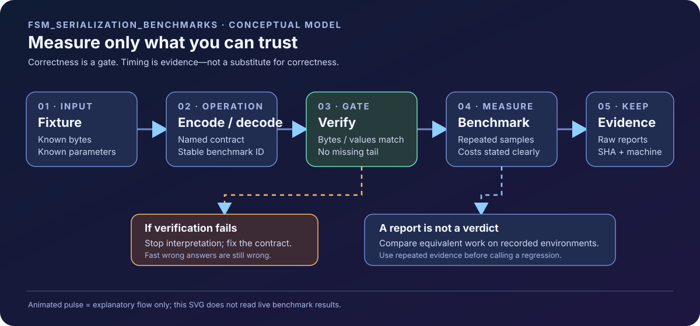

<!-- The Singularity Workshop moniker -->
<p align="center"><a href="https://github.com/TrentBest"></a></p>

# ✳️ 00 FSM_Serialization_Benchmarks

[](https://github.com/TrentBest/FSM_Serialization_Benchmarks/commits/development/)
[](LICENSE.txt)

This repository is the reproducible performance-evidence harness for `TheSingularityWorkshop.FSM_Serialization`. It measures named operations, preserves raw results, and grows from primitive stream costs toward real format-owned FSM workloads.

This README follows the Workshop's shared [Documentation Standard](https://github.com/TrentBest/TheSingularityWorkshop.FSM_COS/blob/master/DOCUMENTATION_STANDARD.md), while keeping this repository's purpose and implementation authoritative.

<p align="center">
  <a href="docs/GALLERY.md"></a>
</p>

**[Explore the living Gallery](docs/GALLERY.md)** · **[Read the Benchmark Catalog](docs/BENCHMARK_CATALOG.md)** · **[Review documentation coverage](docs/DOCUMENTATION_INVENTORY.md)**

## 🟦 01 What

BenchmarkDotNet cases have stable identities in the form `SER-<FAMILY>-<NNN>`. An ID names the operation and semantic contract, not a performance promise. See the [Benchmark Catalog](docs/BENCHMARK_CATALOG.md) before adding, retiring, or comparing a case.

Current measured families include:
- Stream construction, read/write, materialization, positioning, and pack/unpack baselines.
- Output-buffer strategy and primitive integer-encoding cases are planned follow-up families; do not infer that they are present in the current harness source until the corresponding cases appear in the catalog.
- Current workload parameters are 16, 1,024, 10,000, and 100,000 bytes.

The catalog defines the exact contracts and caveats. These primitive cases do not establish the performance of an FSM definition codec that does not yet exist.

## 🟣 02 Why

Performance claims are useful only when another developer can reproduce the workload and understand what was timed. Stable IDs preserve history while raw reports, environment data, source identity, and correctness checks make results reviewable.

Do not compare operations with different semantics as if they were interchangeable. Do not attribute the approximately 21% end-to-end FSM_COS stress-test observation to serialization without a controlled, isolated experiment.

## 🔺 03 How

Requires the .NET 8 SDK. From this repository root:

```sh
dotnet restore
dotnet run --configuration Release
```

The intended automated design separates two lanes:
- **Published-package baseline:** pinned to `TheSingularityWorkshop.FSM_Serialization` NuGet `0.1.0-alpha.2` for historical consumer comparisons.
- **Development-source lane:** tests the source repository first, then builds and benchmarks a direct project reference at the requested full source SHA (or configured development ref).

**Verified CI status (2026-10-28):** `.github/workflows/benchmark.yml` on `development` is the newer GitHub Actions execution host for the exact-source smoke lane. It restores/builds/tests a full source SHA, builds this harness against the source project, runs the correctness-gated `SER-RT-001` dry smoke, verifies a report, and retains provenance. It passed for source SHA `a5476794be3a0d12512bc9effb887d2164ff351d` in [run #40580919972](https://github.com/TrentBest/FSM_Serialization_Benchmarks/actions/runs/40580919972); that proves the smoke path, not a full performance comparison or CiAi policy evaluation. Cross-repository dispatch is now verified: the source observer dispatched exact SHA `da730f0e33239c6031e44fdcc5ee350ac57b385d`, and the existing default-branch workflow `.github/workflows/serialization-benchmarks.yml` ran successfully in [run #40637381835](https://github.com/TrentBest/FSM_Serialization_Benchmarks/actions/runs/40637381835). Both the development-source lane and pinned published-NuGet baseline passed; the source lane verified and retained 30 BenchmarkDotNet reports. Evidence artifacts are retained for 90 days. The dispatch token's required repository access/Contents:write permission is now functioning. **Important distinction:** the successful dispatch run used the existing master-branch workflow, not the newer `development` host adapter; the latter still does not invoke a unified CiAi policy verdict.

Never merge or compare the lanes as if they were the same build. Each run should preserve the source/harness commits, package version or source identity, runtime, OS/CPU, configuration, parameters, BenchmarkDotNet reports, and correctness result.

## 🟢 04 See it in a minute

1. Read the [Benchmark Catalog](docs/BENCHMARK_CATALOG.md) and select a stable ID.
2. Read the [Living Gallery](docs/GALLERY.md) to understand the correctness-to-evidence flow.
3. Run the Release command above.
4. Inspect the generated `BenchmarkDotNet.Artifacts/results` reports.
5. Record the exact source commit and environment with the result.

A successful workflow proves that the configured cases ran and reports were retained. It does not, by itself, prove that one implementation is faster, that a regression threshold is met, or that the complete serialization domain has been benchmarked.

## 🟪 05 Readiness and next work

**Harness readiness: provisional; not a package release verdict.** Stable names are attached to the current stream/round-trip cases, and a catalog records their timed contracts and caveats. The exact-source smoke passed in run [#40580919972](https://github.com/TrentBest/FSM_Serialization_Benchmarks/actions/runs/40580919972), and the existing default-branch workflow completed both the exact-source and pinned published-package lanes in [run #40637381835](https://github.com/TrentBest/FSM_Serialization_Benchmarks/actions/runs/40637381835). The living evidence-flow diagram remains conceptual documentation, not a live dashboard. CiAi policy evaluation and noise-aware performance verdicts remain outstanding.

Outstanding work includes:
- Run and verify the new exact-source workflow on the current harness SHA; add a separate published-package baseline lane and CiAi policy evaluation after the host adapter contract is proven.
- Run the new setup-time byte-for-byte round-trip validation under BenchmarkDotNet; the code change is committed but still needs an actual current-branch build/run.
- Add integer fixed-width/variable-length encoding, signed zigzag, and complete round-trip cases.
- Add string, reference/table, layout/sizing, and concrete FSM definition workloads after the relevant format contract exists.
- Add fair adapters for mature serializer comparisons with equivalent semantics and explicit setup/allocation costs.
- Add malformed-input/resource-safety workloads where meaningful.
- Implement automated result interpretation with repeated comparisons, noise-aware regression policy, and historical deltas.
- Verify cross-repository dispatch and the actual workflow files/runs before claiming the pipeline is healthy.
- Resolve the documentation footer asset gap: `Avatar.jpg` was not found in the checked development tree or the searched Workshop source paths. Do not invent a path or imply the living SVG is the canonical footer replacement.

## Evidence discipline

- Correctness and performance are separate gates.
- Run source tests before source benchmarks.
- Preserve raw reports; never overwrite historical evidence.
- Keep setup, copying, allocations, buffer ownership, and cleanup costs explicit.
- Treat a performance regression as actionable only after confirming semantic equivalence and sufficient repeatability; do not fail on a single noisy sample.
- Do not publish packages from this repository.
- FSM_Serialization package publication remains a separate, explicitly authorized release action.

## Support and related documentation

- [Living Gallery](docs/GALLERY.md)
- [Benchmark catalog and methodology](docs/BENCHMARK_CATALOG.md)
- [Documentation coverage inventory](docs/DOCUMENTATION_INVENTORY.md)
- [FSM_Serialization source repository](https://github.com/TrentBest/TheSingularityWorkshop.FSM_Serialization)
- [FSM_Serialization domain completeness review](https://github.com/TrentBest/TheSingularityWorkshop.FSM_Serialization/blob/development/docs/DOMAIN_COMPLETENESS.md)
- [Shared Workshop documentation standard](https://github.com/TrentBest/TheSingularityWorkshop.FSM_COS/blob/master/DOCUMENTATION_STANDARD.md)
- [Workshop GitHub](https://github.com/TrentBest)
- [Support the Workshop](https://www.patreon.com/TheSingularityWorkshop)

---

<!-- Canonical Avatar.jpg footer not yet applied: no verified Avatar.jpg asset path was found. Do not substitute another image or invent a URL. -->
