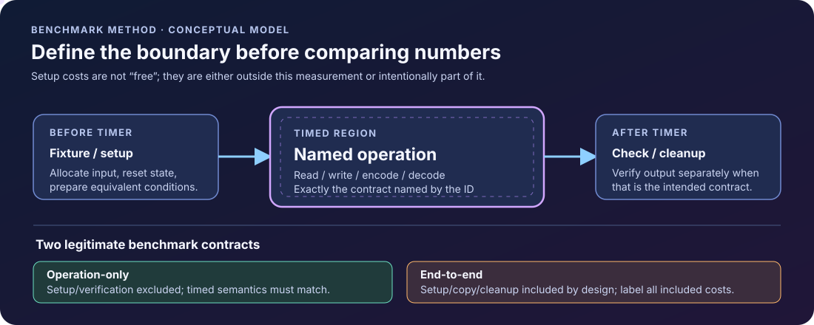

<!-- The Singularity Workshop moniker -->

# FSM_Serialization_Benchmarks — Living Gallery

## 01 — What does this gallery show?

**A benchmark is a claim with a contract.** The workload says what is measured; correctness says whether the result is meaningful; retained evidence lets another person inspect what actually ran.

The visuals here are explanatory models, not live benchmark telemetry. Every exhibit links to the document that owns its detailed contract. The animated pulse illustrates a conceptual flow only—it does not consume current results or prove that any workflow has passed.

## 02 — Why make the evidence visible?

A single number can hide setup costs, allocation, copying, disposal, and semantic differences. The point of a living picture is to make those boundaries easier to notice before a reader compares two results.

## 03 — How to read the evidence flow

Read from left to right:

1. **Fixture:** deterministic inputs and declared parameters establish the workload.
2. **Operation:** a stable benchmark ID names the exact contract being measured.
3. **Correctness gate:** restored data must match the fixture before speed is interpreted.
4. **Measurement:** setup, copying, allocation, buffer ownership, and cleanup costs must be explicit.
5. **Evidence:** retain raw reports with the harness/source identity and machine/runtime details.

The lower branches matter just as much as the main line. A correctness failure blocks performance interpretation. A benchmark report is not automatically a win, regression, or proof of domain completeness.

## 04 — What belongs inside the timer?

There is no universally correct timer boundary; there is a correct boundary for a clearly stated question.

- **Operation-only:** setup establishes equivalent inputs before timing. Output validation can happen outside the measured path when correctness is separately guaranteed.
- **End-to-end:** construction, copying, encoding, decoding, and cleanup may be included when that complete user-visible operation is the question.
- **Fair comparison:** compared cases must measure equivalent semantic work. If setup costs differ, either normalize them or state plainly that the result compares end-to-end contracts rather than isolated primitives.

The current catalog records known differences in setup and ownership costs. Do not compare ratios without reading those caveats.

## 05 — See it in a minute

- **Choose a workload:** [Benchmark Catalog](BENCHMARK_CATALOG.md) defines stable IDs, timed contracts, parameters, and caveats.
- **Run the harness:** from the repository root, use `dotnet restore` followed by `dotnet run --configuration Release`.
- **Inspect the report:** look under `BenchmarkDotNet.Artifacts/results`.
- **Verify the evidence:** record the exact harness commit, package version or source SHA, runtime, OS/CPU, configuration, parameters, and correctness status.

**Current evidence limitation:** the repository's `development` branch has not yet demonstrated a current-branch build and benchmark run for the latest correctness changes. The diagrams explain the intended evidence discipline; they are not a claim that the pipeline is currently green.

## 06 — Choose your next step

- **Understand each measured operation:** [Benchmark Catalog](BENCHMARK_CATALOG.md).
- **Understand purpose, setup, and current limitations:** [Repository README](../README.md).
- **Review applicable documentation views and known gaps:** [Documentation Coverage Inventory](DOCUMENTATION_INVENTORY.md).
- **Understand serialization domain gaps:** [FSM_Serialization domain completeness review](https://github.com/TrentBest/TheSingularityWorkshop.FSM_Serialization/blob/development/docs/DOMAIN_COMPLETENESS.md).
- **Understand the shared standard:** [FSM_COS Documentation Standard](https://github.com/TrentBest/TheSingularityWorkshop.FSM_COS/blob/master/DOCUMENTATION_STANDARD.md).

---

## Visual provenance

| Artifact | Status | What it does not prove |
|---|---|---|
| `serialization-evidence-flow.svg` | Authored conceptual model; animated explanatory pulse | Does not read live results, prove a benchmark ran, or indicate CI status |
| `benchmark-timing-boundaries.svg` | Authored conceptual model; animated pulse within the timed region | Does not decide the correct boundary for every workload or prove compared cases are equivalent |

Edit the SVG source directly; keep its title, accessible description, and matching Markdown text alternative synchronized. GitHub rendering is the presentation target. No interactive controls, source-derived UML, or live-data binding are claimed.

<!-- THE SINGULARITY WORKSHOP FOOTER -->

